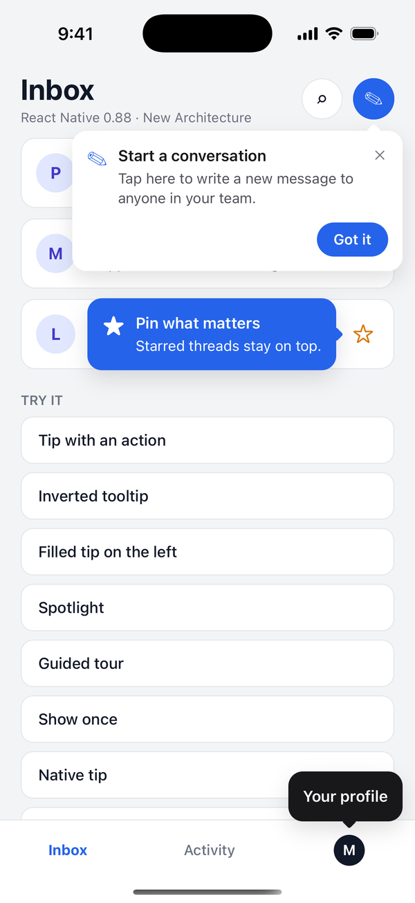
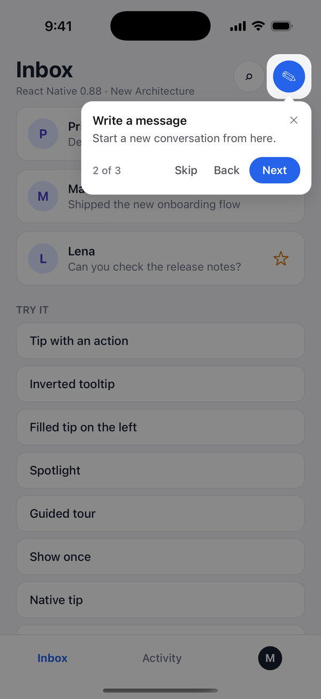
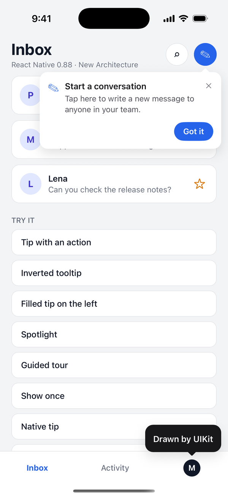
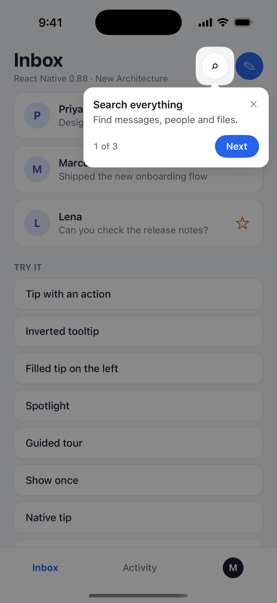
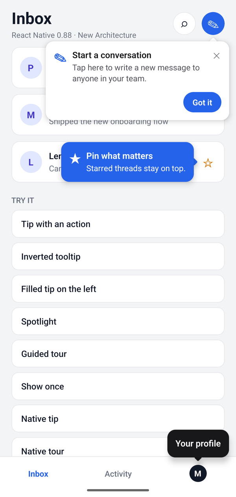
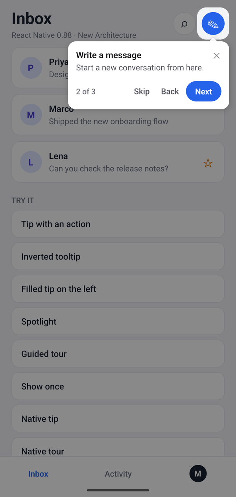
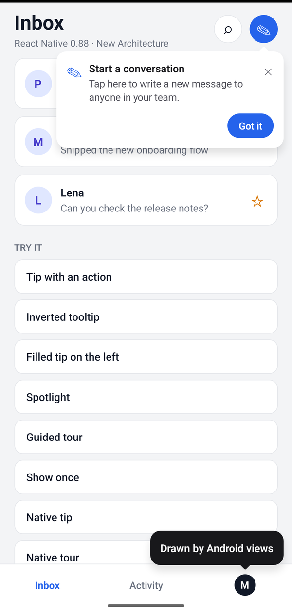
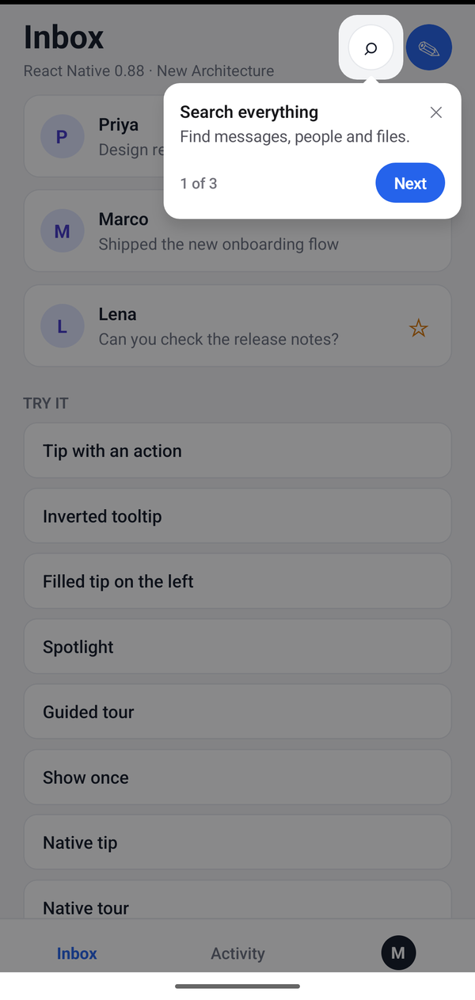

# react-native-anchor-tips

[](https://www.npmjs.com/package/react-native-anchor-tips)
[](https://github.com/mokshupadhyay/react-native-anchor-tips/blob/main/LICENSE)
[](https://github.com/mokshupadhyay/react-native-anchor-tips)

Tooltips, tips and guided tours anchored to any view in React Native, on the old and the New Architecture.

### iOS

<table>
  <tr>
    <td align="center"></td>
    <td align="center"></td>
    <td align="center"></td>
    <td align="center"></td>
  </tr>
  <tr>
    <td align="center">Tips</td>
    <td align="center">Tour with spotlight</td>
    <td align="center">Native tips</td>
    <td align="center">Native tour</td>
  </tr>
</table>

### Android

<table>
  <tr>
    <td align="center"></td>
    <td align="center"></td>
    <td align="center"></td>
    <td align="center"></td>
  </tr>
  <tr>
    <td align="center">Tips</td>
    <td align="center">Tour with spotlight</td>
    <td align="center">Native tips</td>
    <td align="center">Native tour</td>
  </tr>
</table>

- **Point at anything.** Register a view with `<TipAnchor id>` or `useTipAnchor(id)`, or pass a ref. Tips wait for their anchor to mount, follow it when it moves, and close when it unmounts.
- **Smart placement.** Above, below, left or right, chosen by available space or your preference, aligned to the start, center or end, kept inside the safe area, with the arrow always pointing at the anchor.
- **Tips, spotlights and tours.** Actions, close button, auto-hide, dismiss on outside touch, a dimmed spotlight around the anchor, and `tips.tour()` for Next / Back / Skip / Done walkthroughs with a step counter.
- **Show-once rules.** `maxDisplayCount` and `tips.invalidate(id)`, persisted across launches with any AsyncStorage-compatible storage.
- **One API, two renderers.** Tips render with React by default, so any component can be a tip. Pass `presentation: 'native'` and the same tip is drawn by UIKit or Android views in an overlay window above every screen and `Modal`.
- **Wide compatibility.** React Native 0.60+ with React 16.8+. The JavaScript output avoids syntax older Metro releases cannot parse, and the native module ships both a bridge module and a TurboModule.

## Install

```sh
npm install react-native-anchor-tips
cd ios && pod install
```

It has been run on React Native 0.88 (New Architecture) on the iOS simulator and an Android API 37 emulator. Please [report issues](https://github.com/mokshupadhyay/react-native-anchor-tips/issues), especially from older React Native releases and physical Android devices.

Version 0.2.0 refreshed the default look on all three renderers. It uses neutral colors that meet WCAG AA contrast, a clear action hierarchy (a filled primary pill, with Skip and Back in gray), 44pt touch targets, a rounded arrow and matching motion. Your theme overrides still apply on top.

Android links automatically. React-rendered tips need no native code, so they also work in Expo Go. Native presentation requires a development build or a bare app.

## Quick start

Wrap the app in `<TipHost>`, mark the views tips point at, and show a tip:

```tsx
import { TipAnchor, TipHost, tips } from 'react-native-anchor-tips';

export default function App() {
  return (
    <TipHost>
      <Navigation />
    </TipHost>
  );
}

function Header() {
  return (
    <TipAnchor id="compose">
      <ComposeButton />
    </TipAnchor>
  );
}

tips.show('compose', {
  title: 'Start a conversation',
  message: 'Tap here to write a new message.',
  actions: [{ label: 'Got it', style: 'primary' }],
});
```

Pass exact safe-area insets with `react-native-safe-area-context`:

```tsx
const insets = useSafeAreaInsets();
<TipHost insets={insets}>…</TipHost>;
```

Wrapping the app lets a touch outside a tip close it and still reach the app. `<TipHost />` also works without children; then that touch only closes the tip.

### Anchors

```tsx
// A wrapping view
<TipAnchor id="filters"><FilterButton /></TipAnchor>

// Any view you already have
const anchor = useTipAnchor('filters');
<Pressable {...anchor} onPress={openFilters} />

// A ref, without registering an id
const ref = useRef(null);
tips.show(ref, { title: 'Filters' });

// Declarative
<TipAnchor id="filters" tip={{ title: 'Filters' }} visible={isFirstVisit} />
```

Anchors are measured when the tip appears and whenever the anchor lays out again. Scrolling does not trigger a layout, so call `tips.reposition()` from `onScroll` if a tip should follow a scrolling anchor. Rotation is handled automatically.

### Tours

```ts
const tour = tips.tour(
  [
    { anchor: 'search', title: 'Search everything', message: 'Find messages, people and files.' },
    { anchor: 'compose', title: 'Write a message' },
    { anchor: 'profile', title: 'Your profile', placement: 'top' },
  ],
  { showSkip: true, onFinish: ({ completed }) => analytics.log('tour', completed) },
);

tour.next();
tour.stop();
```

Each step is a regular tip with a spotlight on its anchor and Next, Back and Done actions. Closing a step another way ends the tour. Every tip option also works on a step or on the whole tour, for example `{ presentation: 'native' }`.

### Show once

```ts
import AsyncStorage from '@react-native-async-storage/async-storage';

<TipHost storage={AsyncStorage}>…</TipHost>;

tips.show('compose', { title: 'New message', maxDisplayCount: 1 });
tips.invalidate('compose'); // the user found the feature; never show it again
tips.resetHistory();
```

Display history is kept per tip id, which defaults to the anchor id. Tips with a display rule wait until stored history has loaded.

## API

| Call | Result |
| --- | --- |
| `tips.show(anchor, options?)` | Shows a tip next to an anchor id or a ref and returns its id. Showing a visible id updates it. |
| `tips.update(id, options)` | Merges options into a visible or pending tip. |
| `tips.dismiss(id?)` / `tips.dismissAll()` | Dismisses one or every tip. |
| `tips.tour(steps, options?)` | Starts a tour and returns `{ next, previous, goTo, stop, index, active }`. |
| `tips.reposition(anchorId?)` | Measures anchors again. |
| `tips.invalidate(id)` / `tips.resetHistory(id?)` / `tips.displayCount(id)` | Display history. |
| `tips.isActive(id)` | Whether a tip is pending or visible. |
| `tips.configure(config)` | Global configuration, merged under every `<TipHost />`'s props. |
| `useTips()` | Every tip record, for building your own host. |

### Tip options

| Option | Default | |
| --- | --- | --- |
| `id` | the anchor id | Stable id; display history is kept per id |
| `title`, `message`, `icon` | | Text content; `icon` is a glyph, emoji or React element |
| `placement` | `'auto'` | `auto`, `top`, `bottom`, `left`, `right` |
| `align` | `'center'` | `start`, `center`, `end` |
| `showArrow`, `showCloseButton` | `true` | |
| `actions` | `[]` | `{ label, onPress, style: 'default' \| 'primary' \| 'cancel' \| 'destructive', dismissOnPress }` |
| `duration` | `0` | Milliseconds until it hides; `0` keeps it |
| `dismissOnOutsidePress` | `true` | |
| `dismissOnTipPress`, `onPress` | `false` | |
| `spotlight`, `dismissOnBackdropPress` | `false`, `true` | Dim everything except the anchor |
| `maxDisplayCount` | | Show at most this many times |
| `variant` | theme's | `card`, `filled`, `inverted` |
| `theme`, `styles` | | Per-tip theme and style-slot overrides |
| `animation` | `'scale'` | `scale`, `fade`, `none` |
| `presentation` | `'react'` | `react` or `native` |
| `render`, `props` | | Custom content for this tip and data for renderers |
| `onShow`, `onHide(tip, reason)` | | `reason` is `action`, `close-button`, `tip-press`, `outside-press`, `backdrop-press`, `timeout`, `anchor-removed`, `replaced` or `dismissed` |

### `<TipHost />` props

| Prop | Default | |
| --- | --- | --- |
| `maxVisible` | `1` | Tips on screen at once; later tips wait their turn |
| `colorScheme` | `'system'` | `light`, `dark`, `system` |
| `theme`, `lightTheme`, `darkTheme` | | Theme overrides |
| `defaults` | | Default options for every tip |
| `renderer` | | Custom content for every React tip |
| `styles` | | Style slots for every tip |
| `storage` | | AsyncStorage-compatible storage for display history |
| `insets` | | Safe area the tips stay inside |

## Customize

**Theme tokens.** Colors, layout (radius, padding, max width, arrow size, spotlight), typography and shadow:

```tsx
<TipHost
  theme={{
    variant: 'inverted',
    colors: { accent: '#7C3AED' },
    layout: { borderRadius: 10, arrowSize: 6, maxWidth: 280 },
    typography: { fontFamily: 'Inter-SemiBold' },
  }}
  darkTheme={{ colors: { background: '#0B0B0F' } }}
/>
```

Use `createTheme(lightTheme, overrides)` to build a theme object to share.

**Style slots.** `bubble`, `arrow`, `content`, `icon`, `textContainer`, `title`, `message`, `footer`, `step`, `actions`, `action`, `actionText`, `closeButton`, `closeIcon`, `backdrop`.

**Custom content.** The host draws the bubble, arrow and spotlight; a renderer draws what is inside. Renderers receive the resolved options, theme, the final `placement`, `dismiss` and `update`:

```tsx
function PromoTip({ options, dismiss }: TipRenderProps<{ emoji: string }>) {
  return (
    <Pressable onPress={() => dismiss()} style={{ padding: 14 }}>
      <Text>{options.props?.emoji} {options.title}</Text>
    </Pressable>
  );
}

tips.show('deals', { title: 'Weekend sale', props: { emoji: '🎉' }, render: PromoTip });
```

Compose the built-in content with `DefaultTip` when you only need to wrap it.

## Native presentation

```ts
tips.show('compose', { title: 'New message', presentation: 'native' });
```

JavaScript resolves the theme into plain values and measures the anchor. The native module then draws and positions the tip with a line-by-line port of the same placement function:

- **iOS:** a pass-through `UIWindow` above the app's windows, including modals and alerts. It never becomes key, so focus and the keyboard stay with your app. Touches outside a tip reach the app, and touches inside a spotlight reach the anchor.
- **Android:** small application windows sized to the bubble, added over the current activity, so they appear above a `Modal` that was open when the tip appeared. The anchor is found by its view tag for an exact on-screen frame. Touches outside a tip reach the app. A spotlight is a separate full-screen window, and Android does not pass touches between windows, so touches inside the spotlight are swallowed.

Native tips support title, message, glyph icons, actions, the close button, step labels, the arrow, spotlight, timers, outside and backdrop touches, and the `scale`, `fade` and `none` animations. React elements, custom renderers and style slots are React-only. If the native module is missing, the tip falls back to React rendering with a development warning.

## Tips above a `Modal`

- With React rendering, mount a `<TipHost />` inside the modal. The most recently mounted host renders tips, with its props merged over the earlier ones. When it unmounts, tips return to the previous one.
- With native presentation, nothing extra is needed.

## Compatibility

| | Status |
| --- | --- |
| React Native 0.60–0.67 | Bridge module, React 16.8 APIs only, ES2017 output |
| React Native 0.68–0.81, either architecture | Bridge module or TurboModule, chosen from `newArchEnabled` / `RCT_NEW_ARCH_ENABLED` |
| React Native 0.82+ | TurboModule. 0.82 removed the legacy architecture. |

`Appearance` (dark mode) is read when present (0.62+). Older releases use the light theme unless `colorScheme` is set.

## How it works

- `src/core/store.ts` owns every tip's lifecycle: display rules, anchor measurement, phases (`pending`, `visible`, `exiting`), the visible limit and callbacks. Renderers observe it and report when an exit animation finished.
- `src/core/geometry.ts` is the placement algorithm. `ios/AnchorTipGeometry.m` and `android/.../AnchorTipGeometry.java` port it line by line.
- `src/core/resolve.ts` and `src/theme/themes.ts` are the single place where options, defaults and theme tokens become concrete values. React rendering and native serialization both use them.
- `src/core/tour.ts` builds tours from regular tips; `src/core/history.ts` keeps display counts.
- `src/react/` renders React tips. `src/native/` loads the TurboModule or the bridge module, serializes tips and routes native events (press, action, hide) back to the store.
- `ios/` and `android/` draw serialized tips. Android keeps one shared implementation, with thin `newarch` and `oldarch` module classes selected by Gradle.

## Development

```sh
npm install
npm run typecheck
npm test
npm run build
```

`example/` is a React Native 0.88 app. `npm run example:install` packs the library and installs it there the way a consumer would, then `cd example/ios && bundle exec pod install`. To run the scripted screenshots, launch it with `-demo gallery`, `-demo tour`, `-demo native` or `-demo native-tour` on iOS (`xcrun simctl launch booted org.reactjs.native.example.AnchorTipsExample -demo gallery`), or `--es demo gallery` on Android (`adb shell am start -n com.anchortipsexample/.MainActivity --es demo gallery`).
